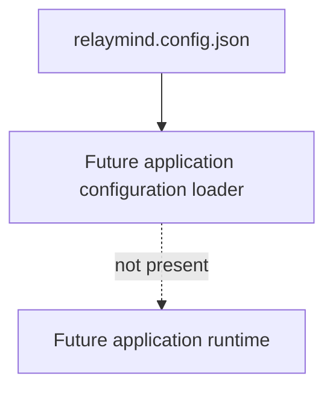

# Aly — RelayMind Configuration Repository

[](#proof-of-concept--enterprise-customization-readiness)

This repository currently contains a single configuration file, `relaymind.config.json`. It is not a complete application or a runnable RelayMind deployment.

## Verified contents

The configuration currently records:
- Repository identifier: `Aly`.
- User identifier: `zopair`.
- Interface language: English.
- Theme: dark.
- A boolean `licensed` flag.
- Empty WhatsApp and Telegram identifier fields.
- A configuration update timestamp.

These are configuration values only. The `licensed` flag is not proof of a legally valid software license, a paid entitlement, or an authorization mechanism. No authentication, messaging integration, or application runtime is present in this repository tree.

## Architecture



## Quick start

There is no application to run. To inspect the current configuration:

```bash
git clone https://github.com/zopair/Aly.git
cd Aly
cat relaymind.config.json
```

## Configuration and privacy

Do not place access tokens, passwords, phone numbers, account IDs, or other secrets in this file. Keep unused integration identifiers empty. If this configuration is later consumed by an application, validate its schema and treat all values as untrusted input.

## Proof of Concept & Enterprise Customization Readiness

**Status: Configuration-only placeholder.**

- [x] One JSON configuration file.
- [ ] Product purpose and requirements.
- [ ] JSON schema and validation.
- [ ] Application source and runtime.
- [ ] Tests and CI.
- [ ] Documented authorization and licensing model.
- [ ] Deployment and operational evidence.

## Change log

- 2026-11-28 — Added README describing the actual configuration-only state.

## Intellectual Property & Authorship

Requested attribution: **Aly Hussein Zopair (علي حسين زبير ALY HUSSEIN ZOPAIR)**. No root software license is present; this README does not grant permission to reuse or distribute repository contents.
